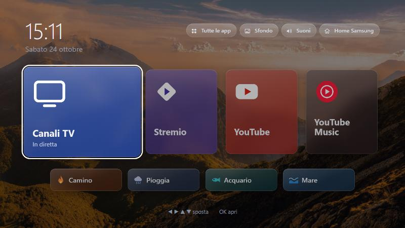
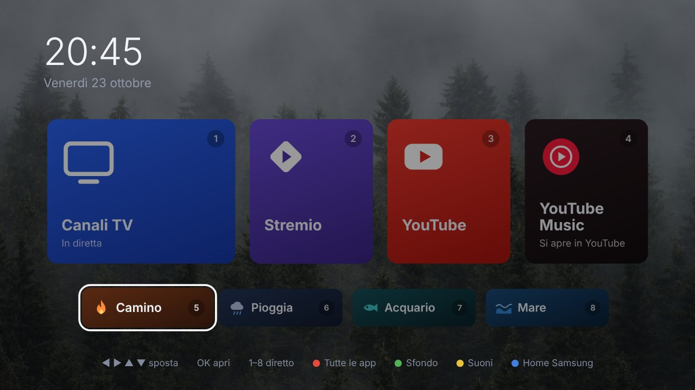
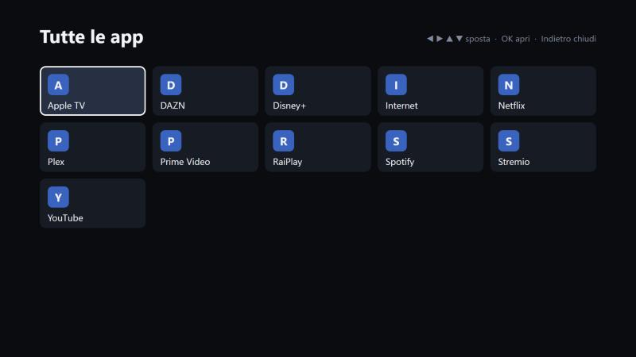

# Quick Home

A clean, fast home screen for Samsung Smart TVs.

Samsung's Home bar is crowded with promotions and apps you never open.
Quick Home is a simpler screen to use instead: four big tiles for what you
actually watch (**live TV, Stremio, YouTube and YouTube Music**), a row of
ambient scenes, and every other app one button away.



## What it does

- **Opens on live TV.** TV channels is always selected, so pressing OK puts you straight on your channels.
- **Works with any remote.** Everything is reachable with the arrows and OK, so the Smart Remote without number or colour keys is enough.
- **Ambient scenes.** Fireplace, rain, aquarium and sea open YouTube straight on a long video. Best with YouTube Premium, so no ads.
- **All your apps.** A button in the settings bar, top right, shows every installed app in a grid.
- **Your look.** Another one switches between 11 wallpapers, photos included.
- **Light and private.** No ads, no tracking; the home screen itself works offline.

| Photo wallpapers and scenes | All apps |
| --- | --- |
|  |  |

## Remote

| Button | Action |
| --- | --- |
| ◀ ▶ ▲ ▼ and OK | Move and open |
| ▲ from the tiles | Settings bar: all apps, wallpaper, navigation sounds, Samsung's own Home |

Remotes with number and colour keys get shortcuts too: 1–4 open a tile,
5–8 a scene, and 🔴 🟢 🟡 🔵 do what the settings bar does, in that order.

## Install it on your TV

You need a Windows PC on the same network as the TV and a free Samsung account.

1. **Build the app.** Download this repo, open PowerShell in its folder and run:
   ```powershell
   powershell -ExecutionPolicy Bypass -File tools\build.ps1
   ```
   This creates `dist\quick-home.wgt`.
2. **Turn on Developer Mode.** On the TV, open **Apps**, type **1 2 3 4 5**,
   switch Developer Mode **on**, enter your PC's IP address and restart the TV.
3. **Install.** Use [Apps2Samsung](https://github.com/Apps2Samsung/Apps2Samsung/releases)
   to send `dist\quick-home.wgt` to the TV. Sign in with your Samsung account
   when it asks.
4. **Pin it.** In **Apps**, select **Quick Home**, choose **Add to Home** and move
   it to the first position. From then on it's **Home**, then **OK**.

## Try it in your browser

Open `src/index.html` in Chrome or Edge. The arrow keys, Enter and 1–8 work
like the remote; **R G Y B** are the coloured buttons and **Esc** is Back.

## Good to know

- **The Home button still opens Samsung's Home bar.** TV apps aren't allowed
  to replace it, so Quick Home is one press away instead (Home, then OK).
- **YouTube Music opens in YouTube**, because Samsung TVs have no separate
  YouTube Music app.
- **Scenes need YouTube.** Each one is just a YouTube video id in
  `src/index.html` (`data-video`), so you can swap in your own favourites.
- **The on-screen text is in Italian.** All of it lives in `src/index.html`
  and `src/app.js` if you want another language.
- Made for a 2021 Samsung Q70A (Tizen 6). Other recent Samsung TVs will
  probably work too, but haven't been tried.

## License

The code is [MIT](LICENSE). The wallpaper photos are not covered by it: they
are from [Unsplash](https://unsplash.com/license), under the Unsplash License,
selected by the [CleanFrame](https://github.com/nthnclrk/CleanFrame) project.
See [CREDITS.txt](src/img/wallpapers/CREDITS.txt).
